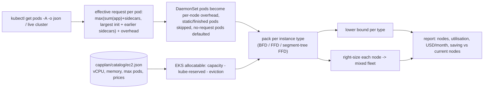

# k8s-capacity-planner

`capplan` answers a question every platform team gets asked: **"how many nodes of which instance type do we
actually need, and what will it cost?"** It reads a Kubernetes cluster's pods (or a `kubectl get pods -o json`
file), works out what each pod really requests the way the scheduler does, and packs them onto nodes with
**2-D bin-packing algorithms**, using real EC2 sizes, EKS allocatable capacity and on-demand prices.

The algorithms are the point of the project:

| Problem | Algorithm | Why |
|---|---|---|
| Fewest nodes for a set of pods (CPU **and** memory **and** a max-pods limit) | First-Fit Decreasing, Best-Fit Decreasing by dominant share | vector bin packing is NP-hard; greedy heuristics are what schedulers and autoscalers use |
| "How good is the heuristic?" | exact **branch and bound** with symmetry breaking and lower-bound early exit | proves the optimum on small instances to measure the gap |
| "Can it be better?" | **lower bound** = max over dimensions of ceil(total / capacity) | if a plan hits it, it is optimal |
| First fit at cluster scale | **segment tree** over nodes holding max free CPU / memory / slots per subtree | O(n·b) scan becomes about O(n log b), with identical results |
| Mixed fleets | right-sizing each packed node to the cheapest type that holds it (price-sorted catalog) | never costs more than the single-type plan |

## Results

Measured in CI (GitHub-hosted `ubuntu-24.04`); every run regenerates these in its job summary.

**Heuristic quality vs the proven optimum** (300 random workloads of 14 pods on m6i.large, requests up to 60% of a
node; branch and bound proved the optimum in all 300):

| Heuristic | Optimal | Extra nodes in total | Worst case |
|---|---|---|---|
| First-Fit Decreasing | 230 / 300 (77%) | 70 | +1 node |
| Best-Fit Decreasing | 223 / 300 (74%) | 77 | +1 node |

The volume lower bound equalled the optimum in 248 / 300 cases, so a plan that hits the bound is usually provably
optimal.

**Speed at cluster scale** (random requests up to 25% of a node):

| Pods | Lower bound | FFD, linear scan | FFD, segment tree | BFD |
|---|---|---|---|---|
| 1,000 | 139 | 141 nodes, 165 ms | 141 nodes, **17 ms** | 141 nodes, 178 ms |
| 5,000 | 693 | 717 nodes, 4.6 s | 717 nodes, **0.24 s** | 715 nodes, 4.4 s |
| 20,000 | 2,761 | (minutes) | 2,933 nodes, **2.7 s** | (minutes) |

Same nodes, same pod placement (property-tested), about 10–20x faster.

**Sample plan** (40 microservices, 164 pods, 59.6 vCPU / 102.5 GiB, ap-south-1): 4 x c6i.4xlarge for
**$1,986/month**, equal to the lower bound for that type (provably the minimum node count), at 94% CPU / 88% memory
of allocatable. Full report: [`examples/plan-ap-south-1.md`](examples/plan-ap-south-1.md).

**End to end on kind:** 10 pods read through the API server (7 workload pods + coredns + local-path-provisioner),
3 DaemonSets turned into per-node overhead, the static control-plane pods and the finished Job skipped, and the pod
with an init container plus a native sidecar resolved to exactly 300m CPU / 144 MiB, as the scheduler computes it.

## How it works



- **Effective requests** follow the scheduler: init containers run one at a time (only the largest counts), native
  sidecars (`restartPolicy: Always` init containers) add to both phases, `spec.overhead` is added on top.
- **Allocatable** uses the EKS AMI formulas (CPU: 6%/1%/0.5%/0.25% per core; memory: 255 MiB + 11 MiB per max pod
  + 100 MiB eviction). For m6i.large that is 1930m CPU and 7518 MiB, matching AWS's documented values.
- **Catalog**: `capplan/catalog/ec2.json` is a dated snapshot (vCPU, memory, EKS max pods, Linux on-demand USD/hour for
  us-east-1, ap-south-1, eu-west-1) built by `scripts/refresh_catalog.py` from the public instances.vantage.sh
  dataset (built from the AWS pricing API).

## Use it

```bash
pip install -e .
capplan sample --services 40 --out pods.json                 # or: kubectl get pods -A -o json > pods.json
capplan plan --pods pods.json --region ap-south-1 --families m6i,c6i,r6i --headroom 0.15
capplan plan --live --region us-east-1 --allow-arm           # current kube context, includes Graviton
capplan bench --trials 300                                   # heuristics vs proven optimum + speed
```

In-cluster: `deploy/cronjob.yaml` runs it nightly with a read-only ServiceAccount (list pods/nodes only),
non-root, read-only root filesystem.

## Tests

- Unit and **property-based tests** (Hypothesis): every packing is valid (each pod once, no node over CPU, memory
  or max pods), never below the lower bound, the exact solver sits between the bound and the heuristics, and the
  segment-tree first fit returns exactly the same packing as the linear scan.
- Kubernetes semantics: quantity parsing, init containers, native sidecars, pod overhead, DaemonSets, static pods.
- **End to end on a kind cluster** in CI: a real workload (Deployments, init container + native sidecar, DaemonSet,
  a pod without requests, a finished Job) is deployed, `capplan plan --live` runs against the API server, and the
  script asserts what was read, including the exact effective request of the init/sidecar pod.

## Limits (deliberately out of scope)

Affinity/anti-affinity, topology spread, taints, PDBs, GPUs and spot pricing are not modelled; the planner answers
"how much capacity", not "where exactly each pod lands". Karpenter does live consolidation; this tool is for
planning, budgeting and right-sizing reviews.
