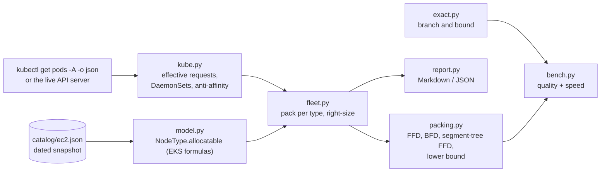

# k8s-capacity-planner: architecture

## 1. Context

"How many nodes of which instance type do we need, and what will it cost?" comes up in budgeting, migrations, right-sizing reviews and before every big launch. The usual answer is a spreadsheet: total CPU ÷ node CPU, plus a guess for overhead. That answer is wrong in predictable ways:
- It ignores memory and the per-node pod limit.
- It ignores DaemonSets and the capacity the kubelet reserves.
- It ignores how init containers and sidecars change a pod's real request.
- It ignores HA rules that forbid two replicas on one node.

`capplan` reads the pods the way the scheduler does, packs them with proper bin-packing algorithms, and prices the result against a real EC2 catalog.

## 2. Components

| Module | Responsibility |
|---|---|
| `model.py` | `Resources` (integers: millicores and MiB, so arithmetic is exact), `Pod`, `NodeType` (with EKS allocatable), `Node` (a bin), and catalog loading |
| `allocatable.py` | EKS AMI reservation formulas. CPU: 6% of the first core, 1% of the second, 0.5% of cores 3–4, 0.25% above. Memory: 255 MiB + 11 MiB per max pod, plus a 100 MiB eviction threshold. For m6i.large that gives 1930m and 7518 MiB, matching AWS's documented values (tested). |
| `kube.py` | Quantity parsing; the scheduler's effective request; DaemonSets turned into per-node overhead; static and finished pods skipped; defaults for pods without requests; anti-affinity groups |
| `packing.py` | Lower bound, FFD, BFD, segment-tree FFD, validation |
| `exact.py` | Branch-and-bound optimum, used to measure the heuristics |
| `fleet.py` | One plan per instance type, then right-sizing each node into a mixed fleet |
| `report.py` | Markdown and JSON reports |
| `bench.py` | Heuristic quality against the proven optimum, and speed at scale |
| `scripts/refresh_catalog.py` | Rebuilds the catalog from the public instances.vantage.sh dataset (derived from the AWS pricing API) |
| `deploy/cronjob.yaml` | Nightly in-cluster run: a read-only ServiceAccount (get/list pods and nodes), non-root, read-only root filesystem |

## 3. Reading pods like the scheduler

- **Effective request** = `max(sum(app containers) + native sidecars, max over init containers of (init + sidecars started before it))`, plus `spec.overhead`. Init containers run one at a time, so only the largest counts. Native sidecars (`restartPolicy: Always` init containers) keep running, so they add to both phases. The kind test checks a real pod that resolves to exactly 300m / 144 MiB.
- **DaemonSets** run one pod on every node, so their requests become per-node overhead, and each takes one pod slot per node.
- **Skipped:** static (mirror) pods and pods that have finished (`Succeeded` or `Failed`).
- **No requests:** given a default (100m / 128 MiB, configurable) and counted in the report, because packing them as zero would understate capacity.
- **Required anti-affinity:**
  - A `requiredDuringSchedulingIgnoredDuringExecution` term with `topologyKey: kubernetes.io/hostname`, whose selector matches the pod's own labels, puts it in a group keyed by namespace and selector.
  - `matchLabels` and `In` expressions are understood. Other operators, other topology keys (zones), preferred terms and terms aimed at other workloads are left out on purpose; the README lists them as limits.

## 4. Packing

The problem is 2-D vector bin packing (CPU and memory), with a third limit (pods per node) and an optional conflict constraint (anti-affinity groups). It is NP-hard, so production schedulers and autoscalers use greedy heuristics. This project uses them, and then measures how far they are from optimal.

| Piece | How | Cost |
|---|---|---|
| Order | Sort by dominant share: the largest fraction of a node the pod uses in any dimension, as in Dominant Resource Fairness | O(n log n) |
| **FFD** | Put each pod in the first node that fits | O(n·b) |
| **BFD** | The node it fits most tightly (least normalised slack left) | O(n·b) |
| **Segment-tree FFD** | A tree over node slots storing the max free CPU, memory and pod slots per subtree; descend left first and skip subtrees that can't fit. Unopened slots hold an empty node's room, so "leftmost fitting slot" is exactly first fit's choice. With anti-affinity, a conflicting node is skipped by searching again from the slot to its right. | About O(n log b); a backtrack happens when maxima come from different nodes |
| **Lower bound** | `max(ceil(ΣCPU / room), ceil(Σmemory / room), ceil(pods / slots), largest anti-affinity group)` | O(n) |
| **Exact** | Depth-first branch and bound. Prune at the best known node count; nodes with identical (free CPU, free memory, pod count, anti-affinity keys) are interchangeable, so try one; open at most one new node per pod; stop early when the lower bound is reached; give up after a node budget (then `optimal=False`) | Exponential worst case; fine for about 15 pods |
| **Right-sizing** | After packing, each node's load is fixed, so swap it for the cheapest type that holds the load and pod count. The node keeps its pods, so anti-affinity still holds. | O(b·t) |

**Correctness argument for the segment tree:** each internal node stores the max of each dimension over its subtree. A subtree whose max can't fit the pod contains no fitting slot, so skipping it is safe. Descending left first returns the leftmost fitting slot, which is first fit's definition. The three maxima may come from different slots, so a subtree can pass the check and still contain no fit. That forces a backtrack, which costs time but never changes the answer. Property tests compare the full placement against the linear scan, with and without groups.

## 5. Results and how they are measured

From CI (see the README for the tables):
- **Quality:** 300 random 14-pod workloads, each proved optimal by branch and bound. FFD is optimal in 77% of them and never more than one node worse; BFD is optimal in 74%. The volume lower bound equals the optimum in 83%.
- **Speed:** at 5,000 pods, segment-tree FFD takes 0.24 s against 4.6 s for the linear scan, with an identical placement. At 20,000 pods it takes 2.7 s.
- **Sample estate**, 164 pods: 4 × c6i.4xlarge at $1,986/month, equal to the lower bound. With HA anti-affinity (31 groups, largest 6), the cheapest plan is $2,172/month, 9% more. That is the price of the HA rule, shown before anyone buys capacity.

## 6. Failure modes and limits

| Situation | Behaviour |
|---|---|
| A pod larger than a node type | That type is left out of the plans; if no type fits, the error names the pod |
| Pods without requests | Defaulted and counted, never treated as zero |
| A stale catalog | The catalog is dated (`fetched`), and `refresh_catalog.py` rebuilds it; prices are on-demand Linux only |
| Soft rules (preferred anti-affinity, topology spread) | Not modelled: the scheduler may break them, so the plan doesn't pay for them |
| Zone spread, taints, GPUs, Spot | Not modelled (README limits). The plan answers "how much capacity", not "which node exactly" |
| Rollouts and node failure | Use `--headroom` (for example 0.15) for maxSurge and N+1 |

## 7. Security

The in-cluster CronJob uses a ServiceAccount that can only get and list pods and nodes. It runs non-root with a read-only root filesystem, and makes no network calls except to the API server (the catalog ships inside the image).

## 8. Testing

| Level | What it proves |
|---|---|
| Property tests (Hypothesis) | Every packing is valid (each pod placed once, capacity, pod limit, anti-affinity); never below the lower bound; exact sits between the bound and the heuristics; the segment tree equals the linear scan exactly |
| Brute force | On tiny instances with anti-affinity groups, the exact solver's answer equals exhaustive enumeration |
| Unit | Quantity parsing; effective requests (init containers, native sidecars, overhead); DaemonSets, static and finished pods; anti-affinity parsing (matchLabels, `In` expressions, zone keys and preferred terms ignored); the HA sample round-trips through pod JSON |
| End to end on kind (CI) | A real workload, including an HA Deployment, read through the API server and checked field by field |

## 9. Next steps

- Zone-level topology spread as a constraint (needs a zone dimension on nodes).
- Spot capacity: interruption-aware plans that keep at least N on-demand replicas per group.
- A Karpenter `NodePool` generated from the recommendation.
